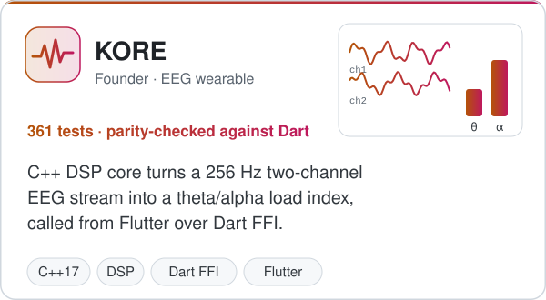
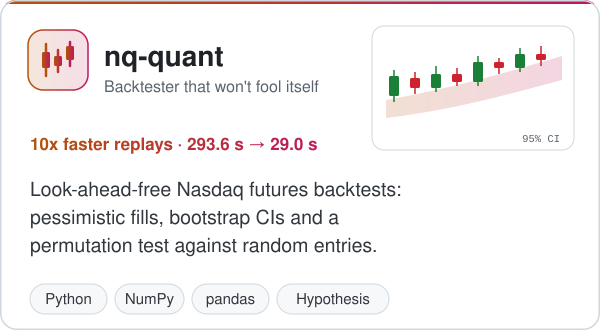
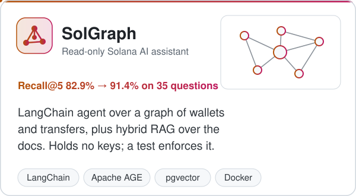
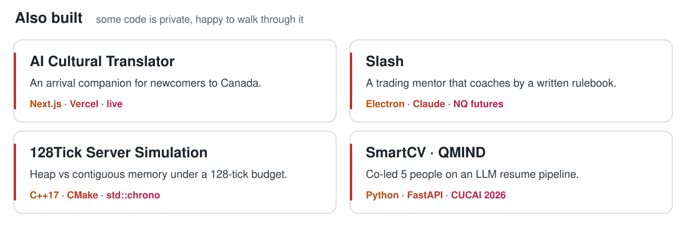

<picture>
  <source media="(prefers-color-scheme: dark)" srcset="assets/header-dark.svg">
  
</picture>

  
  
  

  <a href="https://github.com/Aurikology/shin"><picture><source media="(prefers-color-scheme: dark)" srcset="assets/card-pexi-dark.svg"></picture></a>
  <picture><source media="(prefers-color-scheme: dark)" srcset="assets/card-kore-dark.svg"></picture>
  <a href="https://github.com/Aurikology/nq-quant"><picture><source media="(prefers-color-scheme: dark)" srcset="assets/card-quant-dark.svg"></picture></a>
  <a href="https://github.com/Aurikology/solgraph"><picture><source media="(prefers-color-scheme: dark)" srcset="assets/card-solgraph-dark.svg"></picture></a>

<picture>
  <source media="(prefers-color-scheme: dark)" srcset="assets/also-dark.svg">
  
</picture>

<picture>
  <source media="(prefers-color-scheme: dark)" srcset="https://raw.githubusercontent.com/Aurikology/Aurikology/output/stats-dark.svg">
  
</picture>

<picture>
  <source media="(prefers-color-scheme: dark)" srcset="https://raw.githubusercontent.com/Aurikology/Aurikology/output/snake-dark.svg">
  
</picture>

  <picture>
    <source media="(prefers-color-scheme: dark)" srcset="assets/skills-dark.svg">
    
  </picture>

